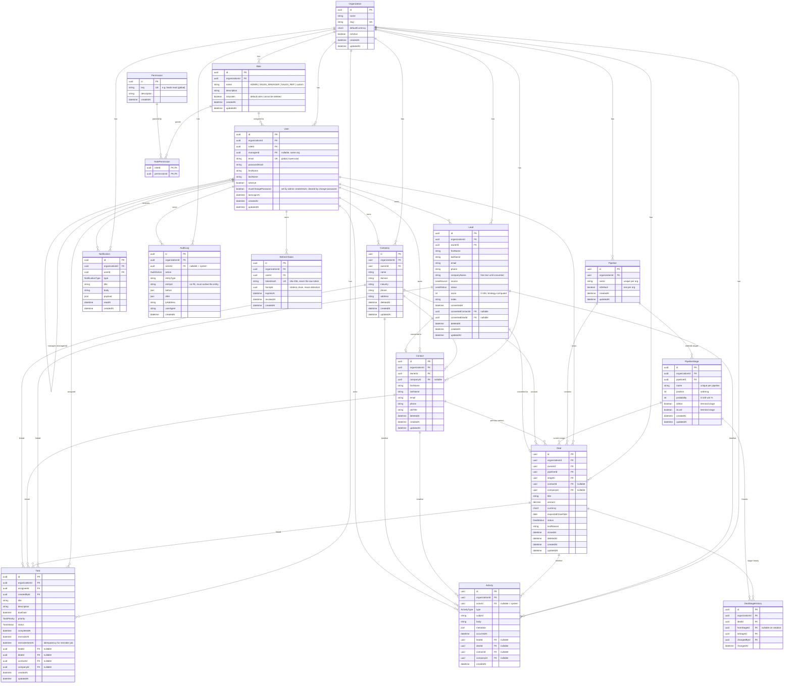

# SalesFlow CRM — Entity Relationship Design

> Status: **approved** (Phase 3, 2026-10-31). All 7 open questions in section 8 were answered "yes, as recommended".
> Scope: 17 entities, multi-tenancy design, delete strategy, indexes, onboarding, open questions.

## 1. Conventions

- IDs: `uuid` (PK `id`). Every table has `createdAt`, `updatedAt` (except append-only tables, which only have `createdAt`).
- Money: `Decimal(14,2)` + `currency` (ISO-4217 code, `char(3)`, validated in the DTO, not a DB enum so adding currencies needs no migration).
- Soft delete (`deletedAt`): `Company`, `Contact`, `Lead`, `Deal` only.
- Enums are PostgreSQL enums via Prisma; values listed in section 3.
- **Users are never hard-deleted** — they are deactivated (`isActive = false`). This makes `Restrict` safe on every FK to `User` and keeps history (owner of a deal, actor of an audit entry) intact.
- `organizationId` is **required and indexed** on every tenant-owned table. Exceptions are listed in section 5.4.

## 2. ERD

Every FK to a tenant-owned table is physically a composite FK `(xxxId, organizationId)` — see section 5.2. The diagram shows the logical FK only, to stay readable.



The 17th entity, `DealStageHistory`, is an addition to the 16 in the starting list. CLAUDE.md requires "stage history" on deals, and a dedicated table is queryable (time-in-stage, funnel reports) where an `Activity` row would not be.

## 3. Enums

| Enum               | Values                                                                                                                             |
| ------------------ | ---------------------------------------------------------------------------------------------------------------------------------- |
| `LeadStatus`       | `NEW`, `CONTACTED`, `QUALIFIED`, `UNQUALIFIED`, `CONVERTED`                                                                        |
| `LeadSource`       | `WEBSITE`, `REFERRAL`, `EMAIL_CAMPAIGN`, `SOCIAL_MEDIA`, `EVENT`, `COLD_CALL`, `PARTNER`, `OTHER`                                  |
| `DealStatus`       | `OPEN`, `WON`, `LOST`                                                                                                              |
| `TaskStatus`       | `OPEN`, `IN_PROGRESS`, `COMPLETED`, `CANCELLED` (overdue is computed from `dueDate`, not stored)                                   |
| `TaskPriority`     | `LOW`, `MEDIUM`, `HIGH`, `URGENT`                                                                                                  |
| `ActivityType`     | `CALL`, `EMAIL`, `MEETING`, `NOTE`, `STAGE_CHANGE`, `SYSTEM`                                                                       |
| `NotificationType` | `TASK_ASSIGNED`, `TASK_DUE_SOON`, `TASK_OVERDUE`, `LEAD_ASSIGNED`, `LEAD_CONVERTED`, `DEAL_STAGE_CHANGED`, `DEAL_WON`, `DEAL_LOST` |
| `AuditAction`      | `CREATE`, `UPDATE`, `DELETE`, `RESTORE`, `LOGIN`, `LOGOUT`, `PERMISSION_CHANGE`                                                    |

`Deal.status` is the business outcome. A deal in a terminal stage (`isWon` / `isLost`) must have the matching status; the service enforces this and the stage move is the only way to change it.

## 4. Delete strategy (`onDelete`)

Principle: **default to `Restrict`**. Data is removed by soft delete or deactivation, so a DB-level cascade is almost never the right tool. `Cascade` is used only for rows that have no meaning without their parent.

| Relation                                                                                                     | onDelete | Why                                                                    |
| ------------------------------------------------------------------------------------------------------------ | -------- | ---------------------------------------------------------------------- |
| `Organization` → every tenant table                                                                          | Restrict | Org offboarding is a deliberate, explicit job, never a side effect     |
| `Role` → `User`                                                                                              | Restrict | A role in use cannot be deleted; reassign users first                  |
| `Role` → `RolePermission`, `Permission` → `RolePermission`                                                   | Cascade  | Pure join rows                                                         |
| `User` → `RefreshToken`                                                                                      | Cascade  | Tokens are meaningless without the user                                |
| `User.managerId` → `User`                                                                                    | Restrict | Reassign the team before deactivating/removing a manager               |
| `User` → owner/assignee/actor FKs (Company, Contact, Lead, Deal, Task, Activity, AuditLog, DealStageHistory) | Restrict | Users are deactivated, never deleted; history keeps its author         |
| `User` → `Notification`                                                                                      | Cascade  | A user's inbox goes with the user (only happens at org offboarding)    |
| `Company` → `Contact`                                                                                        | Restrict | Soft delete is the normal path; avoids orphaning contacts silently     |
| `Contact`/`Company` → `Deal`                                                                                 | Restrict | Same                                                                   |
| `Lead` → `Contact`/`Deal` (`converted*Id`)                                                                   | Restrict | Conversion link is audit-relevant                                      |
| `Pipeline` → `PipelineStage`                                                                                 | Cascade  | Stages belong to the pipeline                                          |
| `Pipeline`/`PipelineStage` → `Deal`                                                                          | Restrict | A pipeline or stage with deals cannot be deleted; move the deals first |
| `Deal` → `DealStageHistory`                                                                                  | Cascade  | History belongs to the deal                                            |
| `Lead`/`Deal`/`Contact`/`Company` → `Task`, `Activity`                                                       | Restrict | These parents are soft-deleted, so rows stay consistent                |
| `AuditLog.entityId`                                                                                          | no FK    | The log must outlive the entity it describes                           |

**Why no `SetNull`:** with composite FKs `(xxxId, organizationId)`, `SET NULL` would also try to null `organizationId`, which is required, and Prisma cannot express a column-subset `SET NULL`. `Restrict` plus soft delete makes it unnecessary.

## 5. Multi-tenancy design

### 5.1 Tenant identity

`Organization` is the tenant root. The tenant is derived **only** from the authenticated user's JWT (`organizationId` claim) and held in the `nestjs-cls` request context. Client-supplied `organizationId` is never used for scoping. Jobs carry `organizationId` in the payload and set it in CLS before running.

### 5.2 DB-level same-org guarantee: composite FKs (recommended)

Every tenant table gets `@@unique([id, organizationId])`. Every FK to a tenant table references that pair:

```prisma
model Deal {
  id             String @id @default(uuid())
  organizationId String
  contactId      String?
  contact        Contact? @relation(fields: [contactId, organizationId], references: [id, organizationId])
  // ...
  @@unique([id, organizationId])
}
```

Result: the database itself rejects a deal in org A pointing at a contact in org B, even if a service has a bug. For optional links, PostgreSQL's default `MATCH SIMPLE` skips the check when `contactId` is null, so nullable links work as expected.

Cost: more verbose Prisma relations and one extra unique index per table. Service-level validation is still needed to return a clean 404/400 instead of a raw FK error.

### 5.3 Centralized scoping: Prisma client extension (implemented in Phase 5, see ADR 0002)

A single `$extends({ query: { $allModels: { $allOperations } } })` on the tenant models:

- reads `organizationId` from CLS;
- adds it to `where` for `findMany/findFirst/count/aggregate/update*/delete*`, and to `data` for `create*`;
- adds `deletedAt: null` for the four soft-delete models (with an explicit opt-out to read deleted rows);
- `findUnique` is rewritten to `findFirst` with the tenant filter, so a foreign-org id returns "not found" (404, never 403).

Known limits, handled in Phase 5: nested writes need the same injection, raw SQL (`$queryRaw`) is **not** scoped and is banned outside reports (where `organizationId` is a mandatory parameter), and auth lookups by email/token hash run before a tenant exists, so they use an explicit unscoped path.

### 5.4 Tables without automatic scoping

| Table            | Why                                                                        |
| ---------------- | -------------------------------------------------------------------------- |
| `Organization`   | It is the tenant root                                                      |
| `Permission`     | Global catalogue (`leads:read`, ...)                                       |
| `RolePermission` | Pure join; tenant is derived through `Role`, so it has no `organizationId` |

`User` and `RefreshToken` are **not** in this list: the extension scopes them too (revised in Phase 5, ADR 0002). Only login/refresh, which run before a tenant exists, use the unscoped client.

### 5.5 Uniqueness

| Constraint                                   | Scope          | Note                                                                                                                      |
| -------------------------------------------- | -------------- | ------------------------------------------------------------------------------------------------------------------------- |
| `Organization.slug`                          | global         | Stable public handle                                                                                                      |
| `User.email` (lowercased)                    | **global**     | Login needs no org selector; one person = one org. See open question 1                                                    |
| `Permission.key`                             | global         | Catalogue                                                                                                                 |
| `RefreshToken.tokenHash`                     | global         | Lookup key                                                                                                                |
| `Role (organizationId, name)`                | per org        |                                                                                                                           |
| `Pipeline (organizationId, name)`            | per org        |                                                                                                                           |
| `PipelineStage (pipelineId, name)`           | per pipeline   |                                                                                                                           |
| `Pipeline` one default per org               | per org        | Partial unique index (`WHERE isDefault`), added as raw SQL in the migration (Prisma lacks it)                             |
| `PipelineStage (pipelineId, position)`       | **not unique** | Reordering would hit transient duplicates (Prisma has no deferrable constraints); the service reorders in one transaction |
| `Contact` / `Company` / `Lead` email or name | **not unique** | Real-world duplicates exist; dedupe is a later feature. See open question 4                                               |

### 5.6 Row-Level Security (option, not implemented)

PostgreSQL RLS would add a second wall: policies like `organizationId = current_setting('app.org_id')`, set with `SET LOCAL` at the start of each transaction. It fits the Prisma extension well but needs every query wrapped in a transaction and a non-superuser DB role. **Recommendation:** skip for now; revisit in Phase 15 (Hardening). Composite FKs + the scoping extension + isolation e2e tests already cover the main risks.

### 5.7 Organization onboarding

No public registration. New organizations are created by an **idempotent CLI script** (`pnpm org:create --name ... --slug ... --admin-email ...`) that, in one transaction, creates the org, its three default roles with their permissions, the first admin user, and the default pipeline and stages. The core seed (Phase 4) reuses the same function for the first org. A protected platform-admin endpoint can be added later if needed.

## 6. Index plan

Rule: tenant-scoped query patterns **lead with `organizationId`**. Soft-deleted rows are filtered by `deletedAt: null`, so lists that need it include `deletedAt` where it helps.

| Table              | Index                                                                                            | Query it serves                                                |
| ------------------ | ------------------------------------------------------------------------------------------------ | -------------------------------------------------------------- |
| every tenant table | `(id, organizationId)` unique                                                                    | Composite FK target (section 5.2)                              |
| `User`             | `(organizationId, roleId)`, `(organizationId, managerId)`                                        | Team visibility: "users whose manager is X"                    |
| `RefreshToken`     | `(userId)`, `(expiresAt)`                                                                        | Revoke-all for a user; cleanup of expired tokens               |
| `Company`          | `(organizationId, ownerId, createdAt)`                                                           | Owner-scoped lists, newest first                               |
| `Company`          | `(organizationId, name)`                                                                         | Search/sort by name (prefix search; `pg_trgm` later if needed) |
| `Contact`          | `(organizationId, ownerId, createdAt)`, `(organizationId, companyId)`, `(organizationId, email)` | Lists, "contacts of a company", search by email                |
| `Lead`             | `(organizationId, ownerId, status, createdAt)`                                                   | Main list: my leads filtered by status                         |
| `Lead`             | `(organizationId, source)`                                                                       | Report: leads by source                                        |
| `Lead`             | `(organizationId, status, convertedAt)`                                                          | Report: conversion rate over time                              |
| `PipelineStage`    | `(pipelineId, position)`                                                                         | Ordered stages of a pipeline                                   |
| `Deal`             | `(organizationId, ownerId, status, expectedCloseDate)`                                           | My open deals, forecast by close date                          |
| `Deal`             | `(organizationId, pipelineId, stageId, status)`                                                  | Kanban board and pipeline summary                              |
| `Deal`             | `(organizationId, status, closedAt)`                                                             | Reports: win rate and revenue by period                        |
| `DealStageHistory` | `(dealId, changedAt)`                                                                            | Stage timeline of one deal                                     |
| `Task`             | `(organizationId, assigneeId, status, dueDate)`                                                  | "My open tasks by due date"; overdue detection                 |
| `Task`             | `(status, dueDate)` partial where open (raw SQL)                                                 | Overdue-checker job across all orgs                            |
| `Task`             | `(organizationId, dealId)`, `(…, leadId)`, `(…, contactId)`, `(…, companyId)`                    | Tasks of an entity                                             |
| `Activity`         | `(organizationId, dealId, occurredAt desc, id)` — same for `leadId`, `contactId`, `companyId`    | Cursor-paginated timeline per entity                           |
| `Notification`     | `(userId, readAt, createdAt desc)`                                                               | Unread inbox and unread count                                  |
| `AuditLog`         | `(organizationId, entityType, entityId, createdAt desc)`                                         | History of one record                                          |
| `AuditLog`         | `(organizationId, actorId, createdAt desc)`                                                      | "What did this user do"                                        |

Pagination choice: **cursor** for `Activity` and `AuditLog` (append-heavy, large); **offset** for all other lists.

## 7. Seed implications (Phase 4)

1. Global `Permission`s (upsert by `key`).
2. Per organization: `Role`s `ADMIN`, `SALES_MANAGER`, `SALES_REP` and their `RolePermission` mapping.
3. First org, first admin user, default pipeline with stages (for example Prospecting → Qualified → Proposal → Negotiation → Won → Lost).
4. Everything via `upsert` on natural keys (`slug`, `key`, `(organizationId, name)`), so a second run changes nothing. Demo data only behind a flag.

## 8. Open questions for you

1. **Login email globally unique?** Recommended yes (simple login, one person = one org). The alternative is `(organizationId, email)` unique plus an org selector at login.
2. **Composite FKs `(id, organizationId)`?** Recommended yes: DB-enforced same-org links for a modest cost in schema verbosity.
3. **`Restrict` on org delete?** Recommended: no org deletion in the app at all; offboarding is a manual or later job.
4. **Duplicate rules:** no uniqueness on contact/company/lead email or name for now (dedupe later). OK?
5. **`Activity` links:** I recommend nullable FKs to Lead/Deal/Contact/Company, same as `Task`, for real integrity and indexed timelines. `AuditLog` is the only polymorphic table (`entityType` + `entityId`, no FK) because it must outlive the entity. This reverses my earlier idea of making both polymorphic.
6. **Onboarding:** idempotent CLI script, no public endpoint. OK?
7. **Money:** `Decimal(14,2)` and `Organization.defaultCurrency` as the default when a deal omits `currency`. OK?
